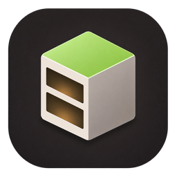

  

<h2 align="center">{{TITLE}}</h2>

<!-- One or two sentences on what this release is about. -->

## ✨ What's new

- 

## 🐛 Fixes

- 

## 📦 Install

Download **`Cubby_{{VERSION}}_x64-setup.exe`** below and run it. Windows 10 and 11, 64-bit.

If Windows warns about the installer, click *More info*, then *Run anyway*: it isn't signed yet.

---

Not an official Minecraft product. Not approved by or associated with Mojang or Microsoft. Cubby is free software under the GPL-3.0.
