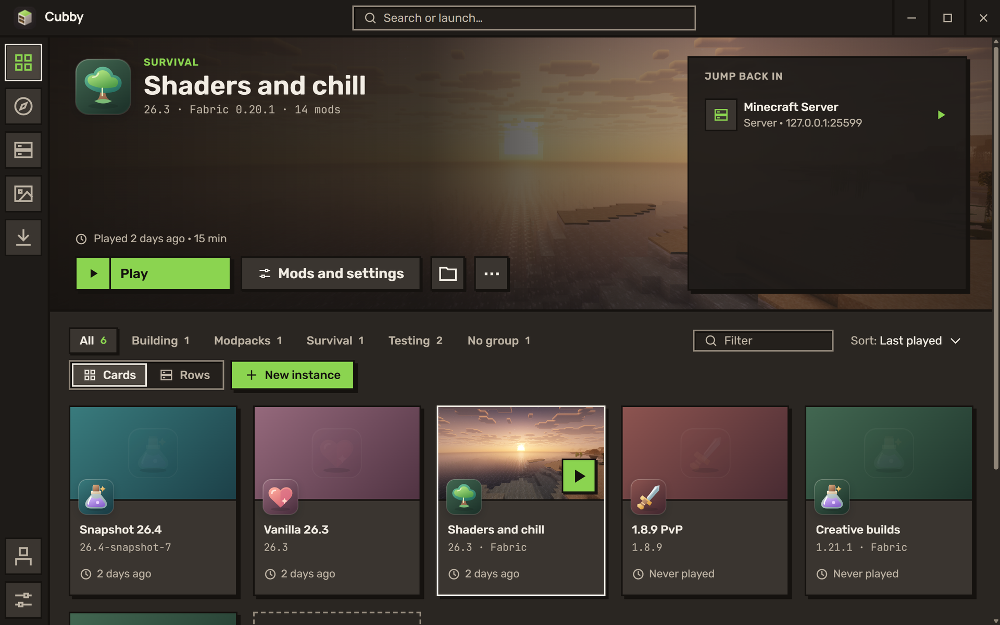

Sign in and play the full game, on Windows, Mac and Linux, with a launcher that keeps itself up to date.

The second test build of Cubby. Thank you to everyone who tried the first one: a lot of what's below comes from what you told me. If something breaks, [open an issue](https://github.com/benjaminbrtrd/Cubby/issues/new) with the crash report from the app.

## ✨ What's new

**Sign in with Microsoft.** Mojang approved Cubby. Sign in with the account that owns Minecraft: Java Edition and play the full game, not just the demo.

**Mac and Linux.** Cubby now runs on macOS, on Apple Silicon and Intel Macs, and on Linux. Same launcher, same features, with the window buttons where your system puts them.

**It updates itself.** When a new version is out, a strip under the title bar tells you. Cubby gets it ready in the background and waits until you've finished playing before it restarts.

**A new Library.** The instance you pick fills the top of the screen, with a big Play button and the worlds and servers you played last. Click a world and you're back in it, no menus in between. Your other instances sit on a shelf below.

**Playing in one click.** First time in Cubby? Pick plain Vanilla, a fast Fabric setup, or paste a server address. Cubby sets it all up and starts the game.

**En français.** Cubby speaks French. It follows your system's language, or you can choose one in Settings.

**Modpacks from everywhere, in one place.** Discover shows the modpacks of Modrinth, CurseForge, FTB, ATLauncher and Technic in the same grid, with filters for the loader and the Minecraft version. CurseForge mods, shader packs and resource packs are in there too.

**The last game log stays.** When the game closes, its log is still there to read, or to send to a mod author.

## 🐛 Fixes

- Filters in Discover fill every page, instead of leaving a handful of results on each.
- Opening a world from the Worlds tab takes you into the world, instead of stopping on the main menu.
- A mod you removed no longer shows as installed on its page.
- Modpack cards no longer show an empty author or zero downloads when the source doesn't give them.
- The Settings list no longer jumps to Updates on its own.

## ⚠️ Good to know

- **Coming from alpha 1?** Install this one by hand, once. From now on, Cubby updates itself.
- This is still a test build. Back up the worlds you care about before you try something new.
