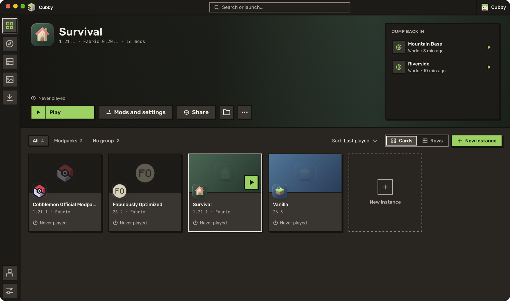

Install a whole set of mods in one go, share a modpack with a link, and change your skin and cape without leaving the launcher.

The first beta of Cubby. The big pieces are in place; what's left is polish and the bugs only you will find. If something breaks, [open an issue](https://github.com/benjaminbrtrd/Cubby/issues/new) with the crash report from the app.

## ✨ What's new

**A download queue.** In Discover, *Install* opens the mod's page in a dialog, and the dialog adds it to a queue with the mods it needs. Add as many as you like, then press *Install all*: everything downloads together, and you follow it in Downloads.

**Share a modpack with a link.** *Share* on any instance makes a link you can paste anywhere, in a chat or a README. The page it opens shows who shared it and what's inside, and *Open in Cubby* installs the whole set as a new instance, with the optional mods left for you to skip. You can also paste a link in *New instance > From a link*.

**Skin and cape.** *Accounts > Skin and cape* shows your skin and every cape you own, with a 3D preview you can turn around. Pick a skin from a file, from a name, or among the nine default skins of the game, choose slim or classic arms, then apply it.

**Servers tell you if you can join.** Cubby asks the server whether it takes your instance's Minecraft version, instead of guessing from a text some servers never update.

**Click anywhere.** Worlds, mods, servers and shader packs open their details when you click anywhere on their row or card, and shader packs can now be deleted from there. The right-hand panel stays in place while the page scrolls.

**Smaller things.** Empty the trash from Downloads. A clearer list of the Java versions on your PC. The last lines of a crash log sit under the ways to fix it. Five emblems per row when you create an instance.

## 🐛 Fixes

- A server no longer shows a false "may not get in" warning when its version text says something odd, like Hypixel's "Requires MC 1.8 / 1.21".
- Menus that opened below the window, like the loader version, now open above when there's no room, and no longer add a scrollbar.
- The pack page keeps its install panel in view instead of scrolling it away.
- The Mac Dock icon has its tile, like other Mac apps.

## ⚠️ Good to know

- **Coming from alpha 2?** Cubby updates itself. If it doesn't offer the update, check that Settings > Updates is on the preview channel.
- Share links hold your Minecraft name, so people see who shared the pack. Nothing else about you.
- Changing a skin or a cape asks Mojang, which limits how often you can do it. Cubby tells you when you hit the limit.
- This is still a test build. Back up the worlds you care about before you try something new.
