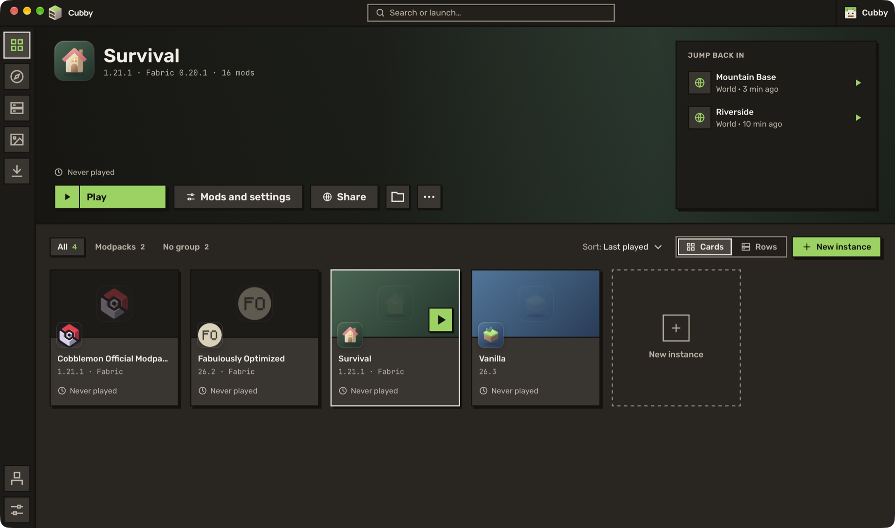

Two fixes for beta 1: your skin shows up again, and English stays English.

A small update to beta 1, made from what you reported. Thank you. If something else breaks, [open an issue](https://github.com/benjaminbrtrd/Cubby/issues/new) with the crash report from the app.

## 🐛 Fixes

- Your skin, your capes and the 3D preview show up in *Accounts > Skin and cape*, and *Apply* works with a skin picked from a name or a default skin.
- Choosing English in Settings > Language now keeps Cubby in English after it restarts, instead of going back to French.

## ⚠️ Good to know

- **Coming from beta 1?** Cubby updates itself. If it doesn't offer the update, check that Settings > Updates is on the preview channel.
- This is still a test build. Back up the worlds you care about before you try something new.
