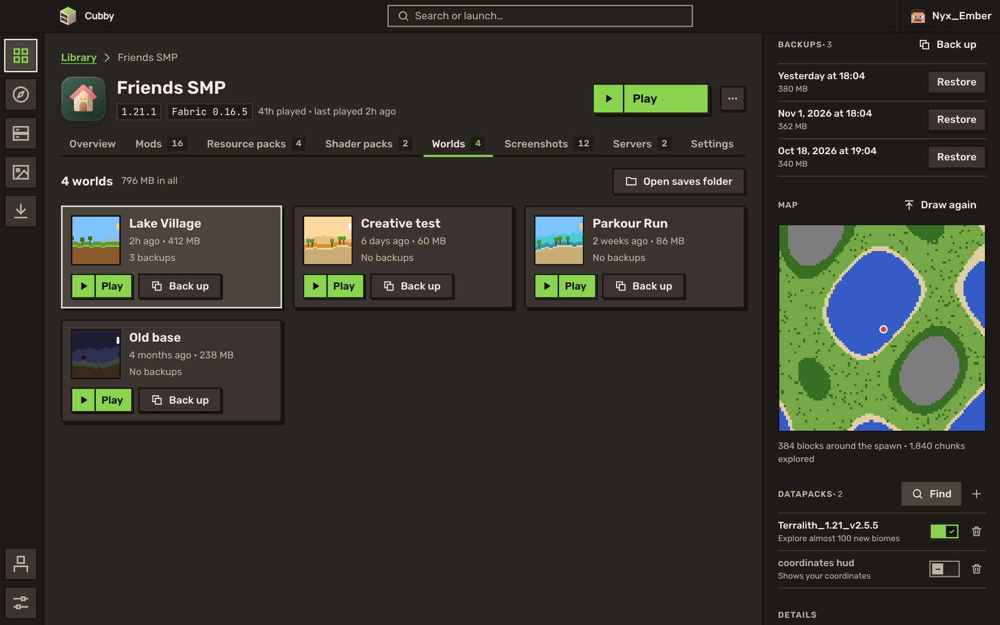

Bring your instances from another launcher, take them anywhere as a modpack, and give each world the datapacks it needs.

The first finished version of Cubby, after two alphas and two betas. Thank you to everyone who tried them and told me what broke. If something still does, [open an issue](https://github.com/benjaminbrtrd/Cubby/issues/new) with the crash report from the app.

## ✨ What's new

**Bring your instances with you.** *New instance, then Import* finds the instances of MultiMC, PolyMC, CurseForge, ATLauncher, GDLauncher, the Modrinth App and the Minecraft Launcher on your PC. Pick the ones you want and Cubby brings them over.

**Export a modpack.** *Export as a modpack file* saves any instance as a Modrinth `.mrpack` or a CurseForge `.zip`, ready to share or to open in another launcher.

**Memory that fits.** With *Set memory automatically*, on by default, each instance gets the memory its mods need: 2 GB for Vanilla, up to 8 GB for big modpacks, and never more than half of your computer's. An instance with its own value keeps it.

**Datapacks for each world.** In the Worlds tab, turn a world's datapacks on and off, or add them from a file. *Discover > Datapacks* searches Modrinth and installs into the world you pick.

**Update mods without fear.** Read each mod's changelog before *Update all*. Cubby keeps the old files, so *Undo last update* puts them back if something breaks.

**Copy settings from another instance.** Key bindings, game options or the server list, in one go, with *Copy from another instance*.

**Desktop shortcuts.** Put an instance on your desktop and double-click it to play, even when Cubby isn't open.

**A map of your world.** See the land around the spawn from above, from the world's panel. It works with Minecraft 26.1 worlds too.

**Server messages like in the game.** The message of the day shows the game's colours and styles, and the server list lines up status, players and ping in neat columns.

**Tidier side panels.** Every side panel now follows the same order: what it is, what state it's in, the main action, then the rest, with deleting at the bottom.

**Cubby remembers its window.** It opens where you left it, at the size you left it.

## 🐛 Fixes

- World icons and screenshots show up on macOS.
- When Fabric refuses two mods that don't work together, like Sodium and Iris, the crash screen names both.
- Buttons no longer stick out of the side panels, and the big map fits its window.

## ⚠️ Good to know

- **Coming from a beta?** Cubby updates itself. You stay on the preview channel and will get the next test builds too: switch Settings > Updates > *Version channel* to *Stable* if you only want finished versions.
- Back up the worlds you care about before you import, export or update a lot at once.
