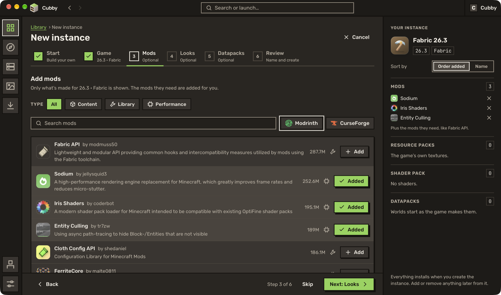

A new way to start an instance, CurseForge as a full source next to Modrinth, and the freedom to go back to the version you liked.

If something breaks, [open an issue](https://github.com/benjaminbrtrd/Cubby/issues/new) with the crash report from the app.

## ✨ What's new

**A wizard for new instances.** *New instance* now walks you through it: start from scratch, from a modpack or from an import, pick the Minecraft version and the loader (or the pack, which sets both), then, if you like, mods, resource packs, a shader pack and datapacks. A summary follows every choice, and everything installs once the instance is ready. Open any mod or pack from the wizard to read its page, then add it from there.

**CurseForge, all the way.** Mods, resource packs, shader packs and datapacks from CurseForge install straight from Discover, like Modrinth ones: Cubby picks the file made for your instance, adds the mods it requires and replaces an older version you already have. Each project has its own page in Cubby, with its description, gallery and every file. Files whose author only allows downloads on curseforge.com get a link to their page.

**Better filters.** Pick several Minecraft versions, loaders and categories at once, on Modrinth and on CurseForge, modpacks included, from every Minecraft release rather than only the newest ones.

**What's in a modpack.** A modpack's page lists its content (mods, resource packs and shader packs) for the version you pick, on every source: Modrinth, CurseForge, FTB, ATLauncher and Technic.

**Go back to an older version.** Every mod, resource pack, shader pack and world datapack from Modrinth or CurseForge has a *Versions* button: pick an older or a newer version and Cubby replaces the file. An instance made from a modpack can switch to another version of the pack: its mods and settings change, your worlds and your own mods stay.

**Updates checked at start.** When Cubby opens, it looks for mod and pack updates in every instance and tells you what it found. Nothing is updated without you, and a mod on a release is only offered releases.

**Where each file comes from.** Mods and packs show the logo of their source (Modrinth, CurseForge or a local file) and an icon for what they are: content, library or performance. A file you installed from CurseForge stays marked as CurseForge, even when Modrinth has the same file.

**Signed for macOS.** The Mac app is signed and notarized by Apple: it opens without the "unidentified developer" warning.

## 🐛 Fixes

- Updating a mod keeps it selected and its panel open: the list no longer flickers while Cubby reads the new files.
- *Versions* opens on the version you have installed, not on the newest one.
- *Hide installed* also works for content from CurseForge.
- CurseForge searches past 10,000 results say "More than 10,000" instead of a capped number.
- Side panels no longer cut versions and statuses; the delete buttons fill the width, with their hint underneath.
- Project galleries show full-size pictures.
- A click outside a dialog closes it.
- The Play button of a Library card no longer covers its menu.
- *Previous* buttons have their chevron, like *Next*.

## ⚠️ Good to know

- **Coming from 2026.11.0?** Cubby updates itself.
- The version filter of the other modpack sources now lists every version, behind *Show all versions*.
