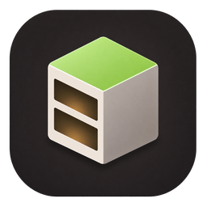
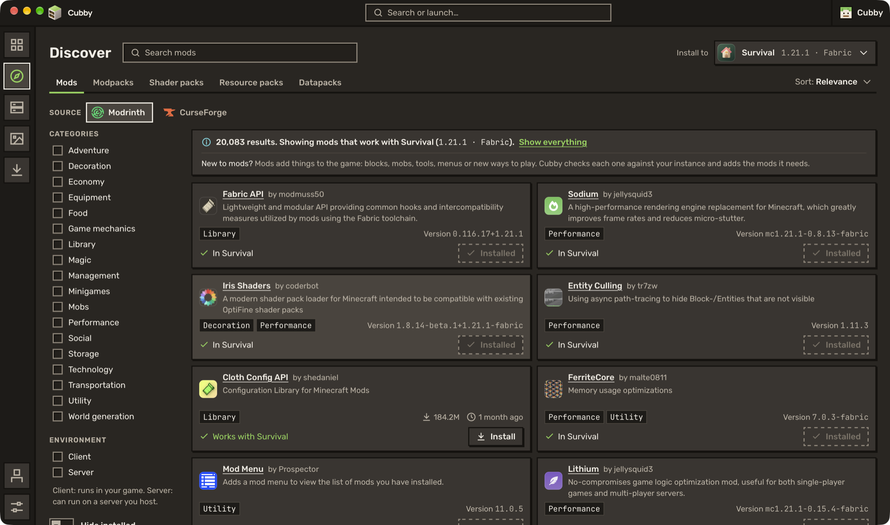
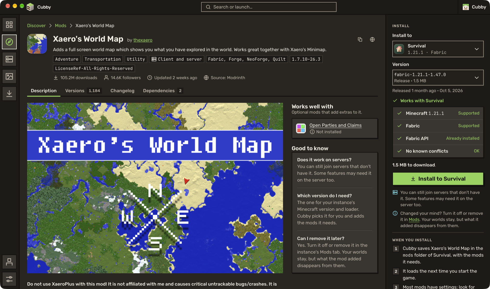
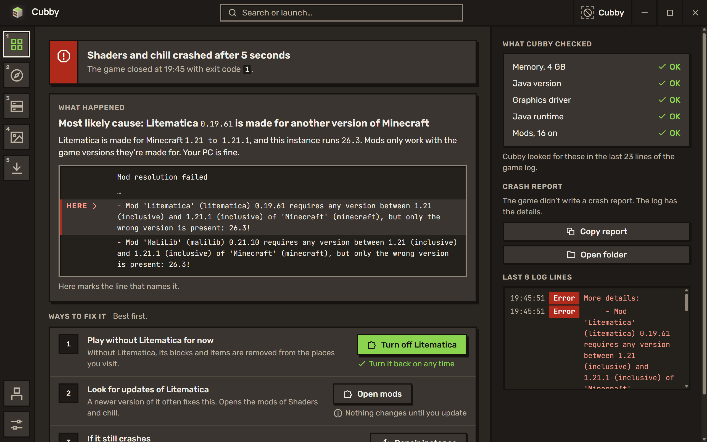

<p align="center">
  
</p>

<h1 align="center">Cubby</h1>

<p align="center">The lightweight Minecraft launcher.</p>


Cubby keeps each of your worlds in its own instance, with its own version, loader, mods and settings. You pick one and press Play: Cubby downloads the game, the loader and the right Java, then gets out of the way.

It's a native app built with Rust and Tauri, so there's no bundled browser and no Java just to open the launcher. The installer is about 11 MB.

## What it does

- **Instances.** Any release, snapshot or old version, with Fabric, Quilt, Forge or NeoForge. Give each one an emblem and a colour so you can spot it at a glance.
- **Mods, resource packs and shaders** from Modrinth and CurseForge, searched from inside the launcher. Cubby only shows what works with the instance you're installing into, adds the dependencies, and finds updates for what you already have.
- **Modpacks** from Modrinth, CurseForge, FTB, ATLauncher and Technic, or from a `.mrpack` or `.zip` you downloaded.
- **Crash diagnosis.** When the game crashes, Cubby reads the log, tells you what most likely went wrong and offers a fix, like turning off a mod made for another version of the game.
- **While you play:** the live game log, your screenshots as you take them, and the status of the server you joined.
- **Also:** world backups, import from Prism Launcher, several accounts, and night, day and high-contrast themes.

| Find mods | Mod pages | When it crashes |
| --- | --- | --- |
|  |  |  |

## Download

Cubby runs on Windows 10 and 11 (64-bit). Get the installer from the [releases page](https://github.com/benjaminbrtrd/Cubby/releases). macOS and Linux builds are planned.

The full game needs a signed-in Microsoft account that owns Minecraft: Java Edition. Without one, Cubby only starts the Minecraft demo. Microsoft sign-in is waiting for Mojang to approve the app.

## Versions

Cubby uses calendar versions: `2026.11.0` is the first release of November 2026, `2026.11.1` the next one that month. Test builds add `-alpha.N` or `-beta.N`. The full year keeps them apart from Minecraft's own version numbers.

To publish a release, push a tag such as `v2026.11.0`: GitHub Actions builds the installer and attaches it to a draft release.

## Building from source

You need [Rust](https://rustup.rs) 1.90 or newer, [Node.js](https://nodejs.org) 20 or newer, and the WebView2 runtime (already installed on Windows 11).

```sh
git clone https://github.com/benjaminbrtrd/Cubby cubby
cd cubby/ui
npm install
cd ..
npm run tauri dev
```

`npm run tauri build` makes the installer in `target/release/bundle/`.

Two values are read at build time, and neither is in this repository:

- `CUBBY_CURSEFORGE_API_KEY`: a [CurseForge API key](https://console.curseforge.com). Without it, CurseForge search is turned off, and everything else works.
- `CUBBY_MSA_CLIENT_ID`: an Azure application id approved for the Minecraft API. Without it, nobody can sign in, so only the demo can be played.

The interface also runs in a plain browser with sample data, which is handy for working on screens: `npm run dev` in `ui/`.

## How the code is laid out

```
crates/
  cubby-common      shared types, paths, HTTP client
  cubby-meta        Mojang versions, Fabric, Quilt, Forge and NeoForge installs
  cubby-java        finding, picking and downloading Java
  cubby-auth        Microsoft sign-in
  cubby-instance    instances, their content, backups, settings
  cubby-launch      building the command line and running the game
  cubby-modrinth    Modrinth search, installs and updates
  cubby-curseforge  CurseForge
  cubby-ftb         Feed The Beast
  cubby-atlauncher  ATLauncher
  cubby-technic     Technic
  cubby-packinstall installing a modpack plan
src-tauri/          the desktop app: window, commands, events
ui/                 the interface, in Svelte
```

Each crate builds and tests on its own. `cargo test --workspace` runs the offline tests; the ones that call real services are marked `#[ignore]` and run with `cargo test -- --ignored`.

## Contributing

Bug reports and pull requests are welcome. See [CONTRIBUTING.md](CONTRIBUTING.md).

## License

Cubby is free software under the [GNU General Public License v3.0](LICENSE).

**Not an official Minecraft product. Not approved by or associated with Mojang or Microsoft.** Made by Benjamin · contact@cubbylauncher.com
