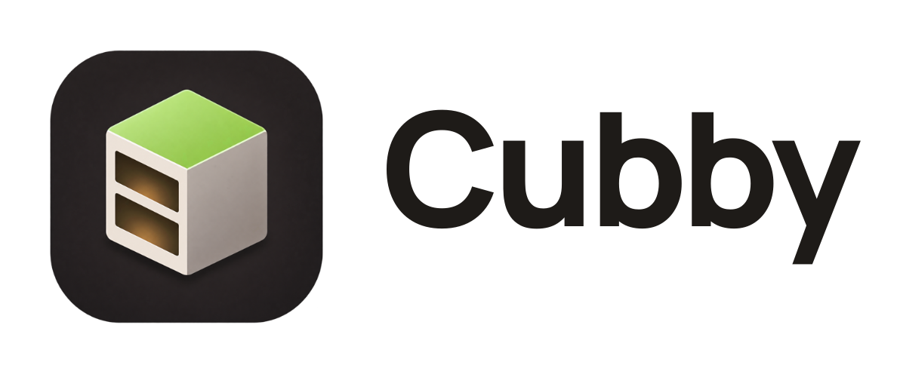
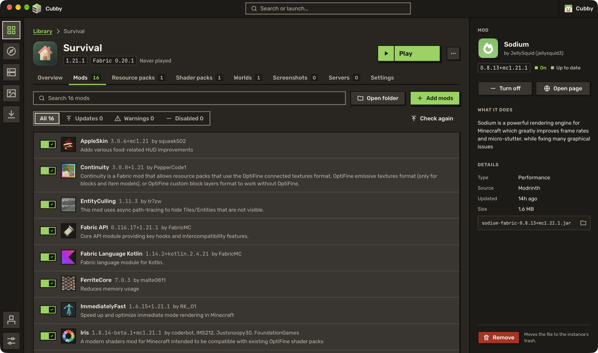
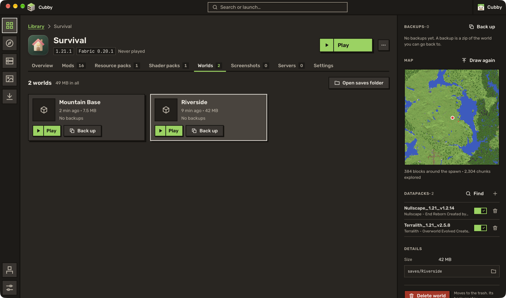
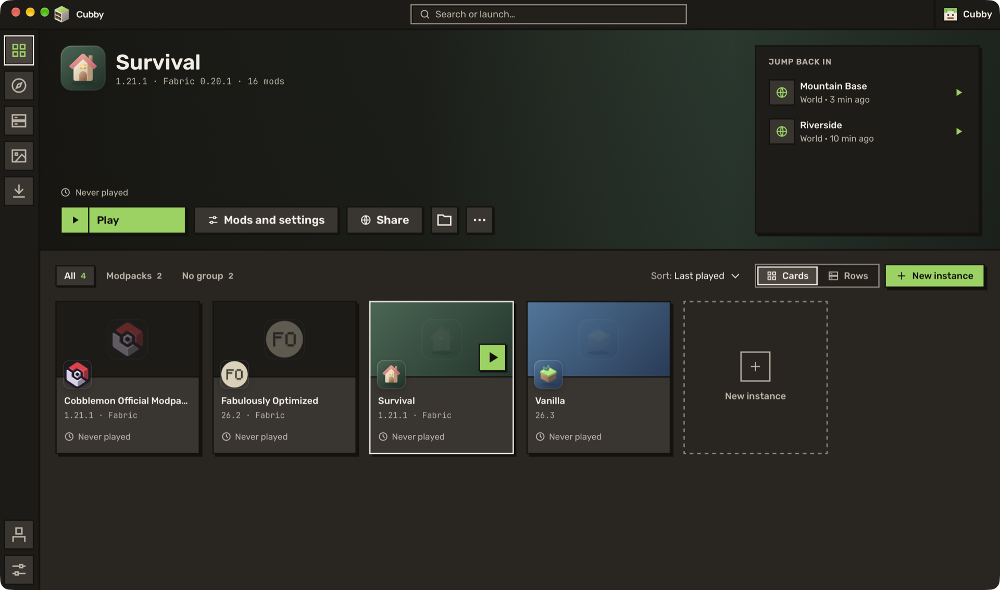

<p align="center">
  <picture>
    <source media="(prefers-color-scheme: dark)" srcset="ui/public/branding/cubby-lockup-on-dark.svg">
    
  </picture>
</p>

<p align="center">A lightweight Minecraft launcher for Windows, macOS and Linux.</p>

<p align="center">
  <a href="https://github.com/benjaminbrtrd/Cubby/releases/latest"><strong>Download</strong></a>
  &nbsp;·&nbsp;
  <a href="https://www.cubbylauncher.com">Website</a>
</p>

<p align="center">
  <a href="https://github.com/benjaminbrtrd/Cubby/releases/latest"></a>
  
  <a href="LICENSE"></a>
  <a href="https://github.com/benjaminbrtrd/Cubby/actions/workflows/ci.yml"></a>
</p>


## Features

- Instances for any Minecraft version, with Fabric, Quilt, Forge or NeoForge
- Mods, shader packs, resource packs and datapacks from Modrinth and CurseForge
- Modpacks from Modrinth, CurseForge, FTB, ATLauncher and Technic
- Mod updates with changelogs, and undo
- World backups and maps
- Import from Prism Launcher, MultiMC, CurseForge, ATLauncher, GDLauncher, the Modrinth App and the Minecraft Launcher
- Export to `.mrpack` or CurseForge `.zip`
- Native app built with Rust and Tauri

<p>
  
  
  
  
</p>

## Building

Requires [Rust](https://rustup.rs) 1.90+ and [Node.js](https://nodejs.org) 20+. On Linux, `libwebkit2gtk-4.1-dev`.

```sh
git clone https://github.com/benjaminbrtrd/Cubby cubby
cd cubby/ui && npm install && cd ..
npm run tauri dev
```

`npm run dev` in `ui/` runs the interface in a browser with sample data.

<details>
<summary>Build-time variables</summary>

- `CUBBY_CURSEFORGE_API_KEY`: [CurseForge API key](https://console.curseforge.com). Without it, CurseForge is turned off.
- `CUBBY_DISCORD_CLIENT_ID`: optional, for Discord Rich Presence.
- `CUBBY_MSA_CLIENT_ID`: optional, to sign in through another Azure application.

</details>

<details>
<summary>Code layout</summary>

```
crates/
  cubby-common      shared types, paths, HTTP client
  cubby-meta        Mojang versions, Fabric, Quilt, Forge and NeoForge installs
  cubby-java        finding, picking and downloading Java
  cubby-auth        Microsoft sign-in
  cubby-instance    instances, their content, worlds, backups, settings
  cubby-launch      building the command line and running the game
  cubby-modrinth    Modrinth
  cubby-curseforge  CurseForge
  cubby-ftb         Feed The Beast
  cubby-atlauncher  ATLauncher
  cubby-technic     Technic
  cubby-packinstall installing a modpack plan
  cubby-discord     Discord Rich Presence
src-tauri/          the desktop app
ui/                 the interface, in Svelte
```

</details>

See [CONTRIBUTING.md](CONTRIBUTING.md) to contribute.

## License

[GPL-3.0](LICENSE). Not an official Minecraft product. Not approved by or associated with Mojang or Microsoft.

Made by Benjamin · contact@cubbylauncher.com
